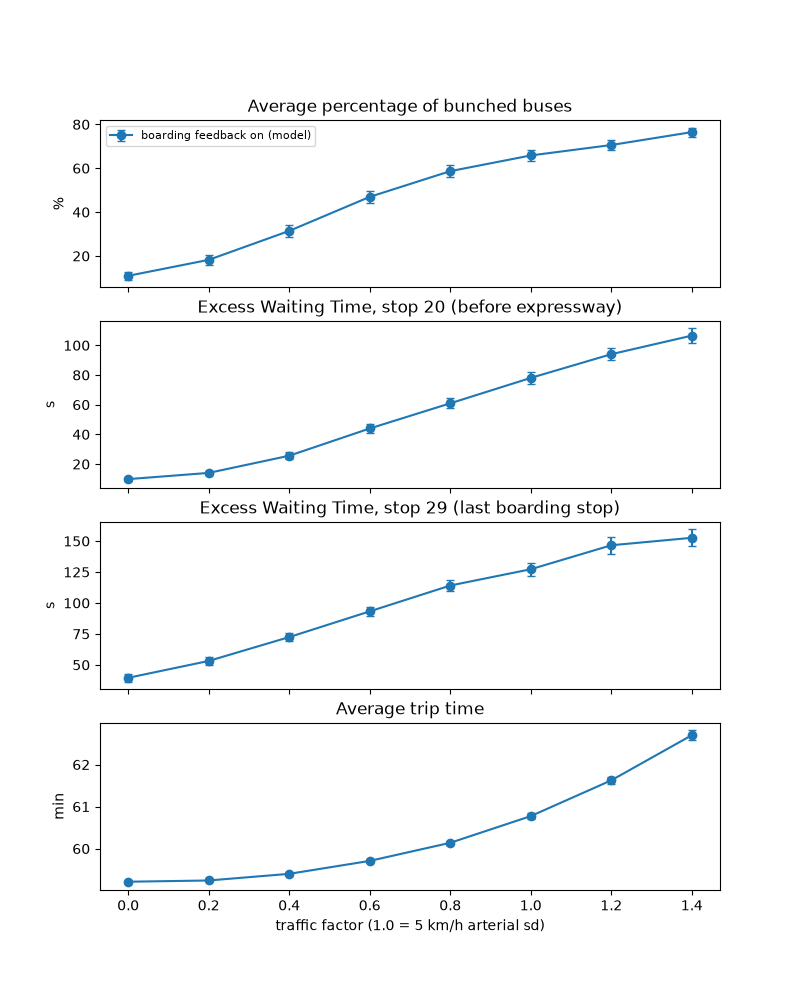
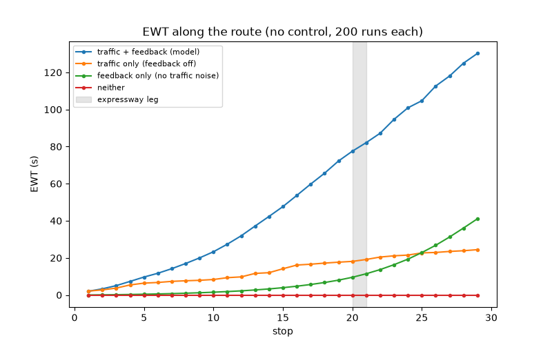
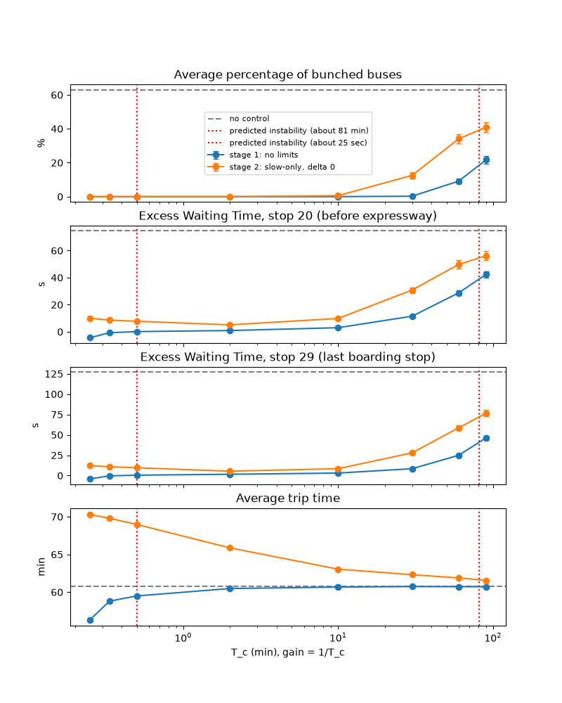
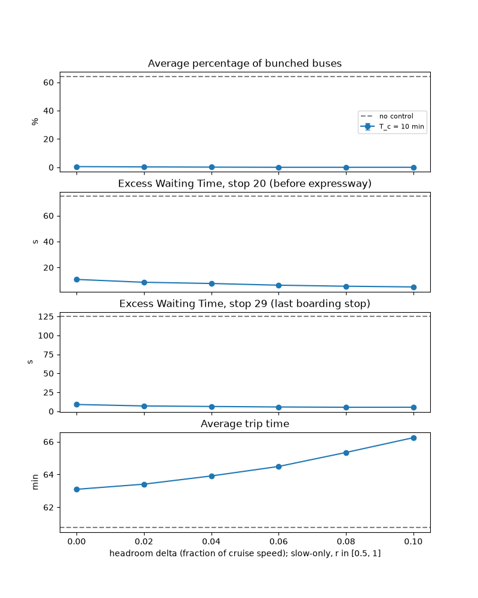
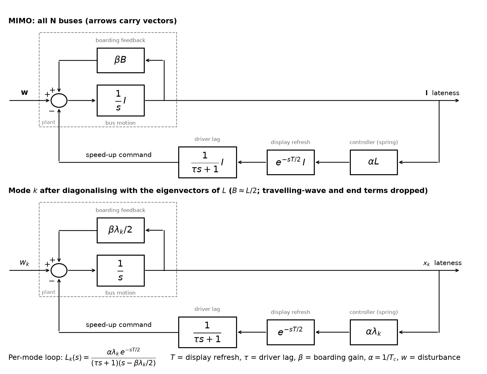
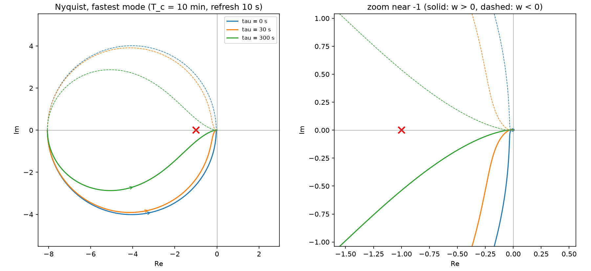

# Bus bunching on Singapore's bus 190

A simulation of bus bunching on SMRT service 190 (Kampong Bahru Terminal to Choa Chu Kang Interchange), built from real LTA stop-distance data and calibrated to the published timetable. The goal is to test a cooperative speed-control law (Daganzo and Pilachowski, 2011) under the constraints a Singapore operator actually faces. The main constraint is that buses can be slowed but not sped up.

**Status:** complete draft (November 2026): uncontrolled baseline, controller, headroom test, stability analysis and driver-lag check. Final polish in progress.

This project was also a way to extend my control background. What I learned along the way, and which results I derived myself, is in [docs/learning_log.md](docs/learning_log.md).


## Headline

Without control, bunching appears even with no traffic noise at all. Uneven passenger boarding alone bunches about 10% of buses over a two-hour evening peak. At the baseline traffic noise this rises to 64%, and excess wait time (EWT) reaches about 2 minutes by the last boarding stop.

A slow-only version of Daganzo and Pilachowski's cooperative speed control, which never asks a bus to go faster than traffic allows, cuts bunching from 64% to under 1% and EWT at the last boarding stop from 129 s to 9 s. It costs about 2.3 minutes of trip time. Adding the paper's speed headroom on top buys almost nothing more at this gain.

## Model

The model is tick-based, with 1-second ticks. Buses are dispatched every 5 minutes, aligning with weekday peak hour headways, over the span of two simulated hours. Each run continues until every bus has reached the terminal.

- **Route:** 31 stops over 22.3 km, from the LTA DataMall BusRoutes API (direction 2). The data is cached in `data/route_190_dir2.json`. It includes a 9.1 km non-stop expressway leg between stop 20 (Raffles Town Club) and stop 21 (Blk 223).
- **Speed:** each bus draws one speed per leg, when it leaves a stop. The draw is a normal distribution truncated at the mean ± 3 sd, so the truncation does not shift the mean (with a floor of 5 km/h arterial and 3 km/h expressway). A *traffic factor* scales both standard deviations. Factor 1.0 is the baseline: 5 km/h on arterial roads, about 13 s of travel-time sd on a typical 0.45 km leg, and 1 km/h on the expressway. Because each bus draws its own speed, the sd represents how differently buses fare on the same leg. On arterial roads that difference is large (one bus catches a red light, the next a green). On a free-flowing expressway, buses a few minutes apart share conditions, so it is small.
- **Dwell:** a fixed 15.6 s per stop, plus 1.52 s per boarding passenger. Boardings are Poisson-distributed, with mean = arrival rate × time since the previous bus left that stop. Late buses therefore pick up more passengers and fall further behind, which is the feedback that causes bunching. The average dwell works out at 29.3 s.
- **Bunching:** a pair of consecutive buses is counted as bunched once the follower catches or passes its leader. Overtaking is allowed.

| Parameter | Value | Source |
|---|---|---|
| Stop distances | 31 stops, 22.3 km | LTA DataMall BusRoutes API |
| Headway H | 5 min | Midpoint of 190's PM-peak frequency of 3–7 min (DataMall BusServices) |
| Boarding time | 1.52 s per passenger | Liu et al. (2017), a Singapore field study of bus stop designs |
| Fixed stop delay | 5.6 s (doors) + 10 s (acceleration and deceleration loss) | Same study. It measured about 9 s to decelerate and 11 s to accelerate; with linear speed ramps, about half of each is lost time (our assumption). |
| Passenger arrivals | 10 per 5 min per stop, the same at every stop | Assumption. Bus capacity suggests about 6–10. |
| Arterial speed | 24.5 km/h (effective) | Calibrated to the 190 timetable, below |
| Expressway speed | 43 km/h (effective) | Calibrated to the 190 timetable, below |

### Calibration

The two speeds are *effective* speeds: they bundle traffic signals, congestion and merging into one number. They were fitted, with traffic noise off, to the scheduled 190 times for departures as per last bus timings.

| Checkpoint | Timetable | Simulated, no noise | Simulated, baseline noise |
|---|---|---|---|
| Stop 20 (9.0 km) | 32 min | 31.4 | 32.3 |
| Stop 21, Blk 223 (18.1 km) | 45 | 44.6 | 45.5 |
| Stop 29 (21.5 km) | 57 | 56.8 | 58.2 |

The last 0.8 km to the interchange takes 5–7 min in the timetable, against about 2.5 min in the simulation. This looks like terminal approach or recovery time rather than driving, and comes after the last boarding stop, so it was not fitted. Noisy legs are slower on average than noise-free ones, because slow legs cost more time than fast legs save. At baseline noise, the time to stop 29 therefore comes out 1.2 min above the timetable.

## Metrics

- **% of buses bunched:** the share of the 25 buses involved in at least one bunching event during the run. An isolated pair counts as 2.
- **Excess wait time (EWT):** at each stop, the headways h are the gaps between consecutive bus arrivals, in the order the buses physically arrive. Then

  AWT = Σh² / (2Σh),  SWT = H/2,  EWT = AWT − SWT.

  EWT is the extra time an average passenger, arriving at random, waits because buses are uneven. It is quadratic in headway, because long gaps both catch more passengers and make each of them wait longer. The first and last bus are left out.

  EWT grows along the route, so an average over all stops would hide where the problem is. It is reported at two stops: **stop 20**, the last stop before the expressway, and **stop 29**, the last boarding stop. The terminal is not used: it is alight-only, so its headways match no passenger's wait.
- **Trip time:** dispatch to terminal, averaged within each run. When control is added, this becomes the cost of control.

All results are means over independent runs with 95% confidence intervals (1.96 × sd / √runs). Each run counts as one sample, since buses within a run are not independent.

## Results: no control



The figure uses 100 runs per level. The table below uses 200 runs per level:

| Traffic factor (arterial sd) | % bunched | EWT stop 20 | EWT stop 29 | Trip time |
|---|---|---|---|---|
| 0 (boarding noise only) | 10.3 ± 1.2 | 9 ± 1 s | 38 ± 2 s | 59.2 min |
| 0.6 (3 km/h) | 45.6 ± 2.0 | 41 ± 2 s | 93 ± 3 s | 59.7 min |
| 1.0 (5 km/h, baseline) | 64.0 ± 1.6 | 77 ± 2 s | 129 ± 3 s | 60.8 min |
| 1.4 (7 km/h) | 75.6 ± 1.3 | 104 ± 4 s | 153 ± 5 s | 62.6 min |

- **Bunching is not only a traffic problem.** With traffic noise switched off, the boarding feedback alone still bunches about 10% of buses. This is the instability that the first term of Daganzo and Pilachowski's control law is designed to cancel.
- **Headway errors amplify along the route.** At baseline, EWT grows from about 24 s at stop 10 to 77 s at stop 20 and about 2 min at stop 29. Passengers late on the route bear most of the cost.
- **The baseline sits on the steep part of the curve,** so the controller will be tested at several noise levels rather than at the baseline alone.

### Why buses bunch: a disturbance and an amplifier

Two mechanisms drive bunching here. Each can be switched off separately:

- **Traffic noise:** random leg speeds.
- **Boarding feedback:** a late bus finds more passengers waiting, dwells longer and falls further behind. Switching it off gives every bus the model's average dwell (29.3 s), whatever its headway.



200 runs each, baseline traffic noise where on:

| Case | % bunched | EWT stop 20 | EWT stop 29 |
|---|---|---|---|
| Traffic noise + boarding feedback (model) | 64.2 ± 1.8 | 77 ± 3 s | 127 ± 4 s |
| Traffic noise only | 6.0 ± 1.0 | 19 ± 1 s | 26 ± 1 s |
| Boarding feedback only | 9.4 ± 1.3 | 9 ± 1 s | 38 ± 2 s |
| Neither | 0.0 | 0 s | 0 s |

- **Traffic noise alone makes headway errors accumulate like a random walk.** EWT rises roughly linearly along the route, but nothing amplifies the errors.
- **Boarding feedback alone amplifies even the small randomness in boarding numbers.** EWT starts near zero and accelerates along the route.
- **Together they are far worse than the sum:** 127 s at the last boarding stop, against 26 + 38 s. In control terms, the boarding feedback is an unstable plant and traffic noise is the disturbance it amplifies. This is why the controller needs a real restoring force, not just smoothing.


## Control

The controller is based on Daganzo and Pilachowski (2011). Each bus adjusts its speed using the gaps to the bus in front and the bus behind, as if neighbouring buses were joined by springs.

**Measuring the gaps.** The route has two speeds, 24.5 km/h arterial and 43 km/h on the expressway, so a distance gap does not translate directly into a time gap. The route is therefore mapped onto an equivalent arterial coordinate: the expressway leg is shrunk by 24.5/43, and each stop adds the distance an arterial bus covers during an average 29.3 s dwell. A gap in this coordinate divided by 24.5 km/h is a nominal time headway. This is a model-based estimate: it assumes nominal speeds and average dwells, not each bus's actual ones.

**The law.** Each bus gets a speed fraction r, which multiplies its drawn leg speed:

  r = 1 − δ + (e_front − e_rear) / T_c

Here e_front and e_rear are the front and rear headway errors (nominal headway − H), T_c sets the gain (α = 1/T_c), and δ is optional headroom. A bus with no neighbour, the first or the newest, treats the missing one as sitting at exactly the ideal headway. The target is refreshed every 10 s, as an in-cab display would be. Two configurations:

- **No limits:** any r. This checks the theory, not a realistic design.
- **Slow-only:** r is capped at 1, so a bus is never asked to go faster than traffic allows, with a floor of 0.5.

**Stability.** The analysis below predicts a window for the gain. With T_c above about 81 min, the spring is too weak to beat the boarding feedback. With T_c of only tens of seconds, the 10 s display refresh makes each correction overshoot. Over a single trip of about an hour, crossing the 81 min limit is gradual: just past it, errors grow far more slowly than without control. In the sweep below, performance worsens smoothly as T_c approaches it.



200 runs each, baseline traffic noise:

| Configuration | % bunched | EWT stop 20 | EWT stop 29 | Trip time |
|---|---|---|---|---|
| No control | 64.0 ± 1.6 | 77 ± 2 s | 129 ± 3 s | 60.8 min |
| No limits, T_c = 10 min | 0.0 | 3 s | 3 s | 60.7 min |
| Slow-only, T_c = 10 min | 0.4 ± 0.3 | 11 ± 1 s | 9 ± 1 s | 63.1 min |
| Slow-only, T_c = 60 min | 32.9 ± 1.6 | 50 ± 2 s | 59 ± 2 s | 61.9 min |
| Slow-only, T_c = 30 s | 0.0 | 8 s | 9 s | 69.0 min |

- **Slow-only control works with a strong enough gain.** At T_c = 10 min it removes nearly all bunching. It costs about 2.3 min of trip time, because buses can only ever be slowed.
- **A weak gain is not enough when buses can only slow down.** At T_c = 60 min, slow-only control only halves bunching. A bus that falls behind cannot catch up, so half the spring is missing.
- **Too strong a gain is expensive.** At T_c = 30 s, buses spend much of their time at the speed floor, and trips take about 8 minutes longer.

### Headroom: not needed at a strong gain

Daganzo and Pilachowski run every bus slightly below cruise speed, by a headroom δ, so that a bus that falls behind still has room to speed up when commands are capped. I tested this on the slow-only controller at T_c = 10 min.



200 runs each, baseline traffic noise:

| Headroom δ | % bunched | EWT stop 20 | EWT stop 29 | Trip time |
|---|---|---|---|---|
| 0 | 0.4 ± 0.3 | 10 ± 1 s | 9 ± 1 s | 63.0 min |
| 0.02 | 0.2 ± 0.2 | 9 ± 1 s | 8 ± 1 s | 63.5 min |
| 0.04 | 0.0 | 7 ± 1 s | 7 ± 1 s | 64.0 min |
| 0.06 | 0.0 | 7 ± 1 s | 6 ± 0 s | 64.5 min |
| 0.08 | 0.0 | 6 ± 0 s | 5 ± 0 s | 65.3 min |
| 0.10 | 0.0 | 5 ± 0 s | 5 ± 0 s | 66.3 min |

- **Headroom costs trip time almost in proportion.** Each 0.01 of δ adds about 0.3 min, because every bus runs slower all the time.
- **It buys very little.** EWT at the last boarding stop falls from 9 s to about 5 s, a difference no passenger would notice. The no-limits controller at the same gain (3 s) is the ceiling on what headroom could ever recover.
- **A strong gain does headroom's job.** Headroom lets late buses speed up. A strong enough gain gets the same correction the other way: the buses ahead slow down to wait for them. With a weak gain, headroom mattered more: in early runs at T_c = 60 min, δ = 0.05 roughly halved bunching. (Those runs predate a fix to the control timing, so treat them as indicative only.)

So the controller used here is slow-only with no headroom: δ = 0, T_c = 10 min.

## Stability analysis

This section analyses the no-limits controller as a linear system. The slow-only cap is a saturation, which this analysis does not cover; those results come from the simulation.

**The platoon as a MIMO system.** Let lₙ be bus n's lateness against its nominal schedule, in seconds. Two things change it:

- **Boarding.** A front gap e seconds longer than H brings b·q·e extra seconds of dwell at each stop. Spread over the time between stops, this makes lateness grow at β·eₙ, with β = b·q/T_s ≈ 1.49 per hour (b = 1.52 s per passenger, q = 1/30 passengers per second, T_s = 122 s). The per-stop factor b·q ≈ 0.05 is what Daganzo (2009) calls the attraction parameter. He gives typical values of 0.01 to 1, and about 0.1 for a busy San Francisco line at rush hour, so this route sits in the normal range. This feedback mechanism was first described by Newell and Potts (1964).
- **Control.** The speed fraction r = 1 + α(e_front − e_rear) changes lateness at rate 1 − r.

Stacking all N buses gives

  dl/dt = βB·l + u + w,  u = −αL·l

where w is the disturbance (traffic and boarding noise). B holds each bus's front headway error, so it is one-sided. L is the spring's graph Laplacian. A missing neighbour at either end is a ghost at the ideal headway.



**Reducing it to single loops.** L is symmetric. Its eigenvectors are cosine waves along the platoon, with eigenvalues λₖ = 2 − 2cos(kπ/N), all between 0 and 4. B is not symmetric, but it splits exactly as B = ½L + C + D:

- **½L:** half of B is the Laplacian itself.
- **C:** a skew-symmetric part. It moves patterns of lateness along the platoon (travelling waves) and cannot make them grow.
- **D:** two end terms.

Keeping only the ½L part, the eigenvectors of L decouple the system into one loop per mode, each with plant 1/(s − βλₖ/2) and controller gain αλₖ. For N = 12, the resulting closed-loop poles are within 0.5% of the exact eigenvalues of βB − αL.

**Continuous or sampled?** The simulation advances in 1 s ticks, and the display refreshes every T = 10 s, holding each command in between. So the real controller is sampled, not continuous. The dynamics that matter are much slower than either: the boarding instability grows with a time constant of about 20 min, and at T_c = 10 min the controller corrects errors over about 3 min. Over one 10 s refresh, an error changes by only about 6%. The analysis therefore treats the system as continuous, with one exception: the upper limit on the gain. That limit only appears when corrections become fast enough to be comparable with the refresh interval, so it needs the sampled model.

**Lower limit on the gain.** Each mode has one unstable open-loop pole, at p = βλₖ/2, which is the boarding feedback. The closed-loop pole is (β/2 − α)λₖ, so every mode is stable if and only if α > β/2, which is T_c below about 81 min. The ratio of controller gain to plant pole is 2α/β for every mode, so all modes reach this limit together. Applying Gershgorin's theorem to the full matrix βB − αL, with no approximation, gives a weaker but guaranteed condition: α ≥ β, or T_c ≤ 40 min. The chosen T_c = 10 min (α = 6 per hour) satisfies both by a wide margin.

**Upper limit on the gain (sampled model).** For each mode, write K = αλₖ for the controller gain and p = βλₖ/2 for the boarding pole. Over one refresh, the command is held at the value set from the error at the start, so the error is multiplied by a fixed factor z each refresh:

  z = e^{pT} − (K/p)(e^{pT} − 1) ≈ 1 − (K − p)T

The mode is stable if −1 < z < 1:

- **z < 1** reduces exactly to K > p: the lower limit above, recovered from the sampled model.
- **z > −1** requires (K − p)T < 2, approximately. If a correction over one refresh is larger than the error itself, it overshoots, so the error changes sign at every update. If it is more than twice the error, each overshoot is bigger than the last.

The fastest mode has K ≈ 4α, so the upper limit is T_c > 2T = 20 s. When (K − p)T is small, z ≈ e^{−(K−p)T}, which is the continuous pole s = −(K − p). This is why the continuous analysis holds at the chosen gain: there (K − p)T ≈ 0.06, and the two models agree to 0.1%.

**Driver lag and the Nyquist plot.** For the fastest mode, with the refresh approximated as a delay of T/2 and a first-order driver lag τ, the open loop is

  L(s) = αλ e^{−sT/2} / ((τs + 1)(s − βλ/2))

With one unstable open-loop pole, the Nyquist plot must encircle −1 once anticlockwise; it does so in every case below. At T_c = 10 min:

| Driver lag τ | Crossover (rad/s) | Phase margin |
|---|---|---|
| 0 | 6.5 × 10⁻³ | 81° |
| 30 s | 6.4 × 10⁻³ | 70° |
| 300 s | 4.1 × 10⁻³ | 27° |

A lag of tens of seconds costs about 10° of phase; only a lag of several minutes would threaten stability. Ignoring the refresh, the closed-loop characteristic equation is the quadratic τs² + (1 − τp)s + (K − p). Both roots have negative real parts only if all three coefficients are positive, which requires τ < 1/p ≈ 20 min: the driver must respond faster than the boarding instability grows.



**Driver lag in simulation.** The simulation can add a first-order lag between the displayed command and the speed the driver actually applies (`driver_lag` in `simulate_run`). 200 runs each, T_c = 10 min, baseline traffic noise:

| Driver lag τ | No limits: % bunched | No limits: EWT stop 29 | Slow-only: % bunched | Slow-only: EWT stop 29 |
|---|---|---|---|---|
| 0 | 0.0 | 3 s | 0.4 ± 0.2 | 8 s |
| 30 s | 0.0 | 3 s | 0.6 ± 0.3 | 9 s |
| 5 min | 0.0 | 6 s | 2.3 ± 0.6 | 12 s |

As predicted, a 30 s lag makes no measurable difference, and even 5 minutes costs only a few seconds of EWT. At the predicted limit of 20 min, performance degrades sharply (no limits: 8% bunched, EWT 29 s), but nothing blows up within a single trip, as expected for growth that is only just unstable. The slow-only controller is more sensitive to lag, which the linear analysis cannot show.

**What the analysis leaves out.**

- **The slow-only cap and saturation.** These are covered by simulation only.
- **The travelling-wave and end terms.** Because B is one-sided, the system is non-normal: a disturbance can grow briefly as it passes down the platoon, even when every mode is stable.
- **How large errors get.** That depends on the disturbances, which the simulation measures as EWT and % bunched.

The method of diagonalising a bidirectional platoon and checking each mode follows Lestas and Vinnicombe (2007); the sampled stability condition matches Daganzo and Pilachowski's αΔt < 0.5.

## Future work

- **A discrete driver display.** Daganzo and Pilachowski suggest showing drivers an approximate speed limit on a screen. Rounding the command to a few levels would test whether drivers could realistically follow this controller.
- **Trajectory-based headways.** Measuring headways from when the bus ahead actually passed, instead of from nominal speeds, would remove the estimation error noted below.
- **Holding at stops** as an alternative to slowing buses on the road, and a realistic demand profile with bus capacity.

## Assumptions and limitations

- Traffic noise is independent across buses and legs. Real congestion is shared, so the baseline is probably pessimistic.
- Demand is uniform across stops. Bus capacity and alighting are not modelled, so a full bus keeps gaining boarding delay. This probably makes bunching worse than reality.
- Dispatch is perfectly even, which is optimistic.
- Buses can overtake freely.
- Speeds are lumped effective values, calibrated to off-peak (after 23:30) scheduled times. Peak trips are probably slower.
- H = 5 min is the midpoint of a published 3–7 min range. The real headway varies through the evening.
- The controller estimates headways from nominal speeds and average dwells, not from each bus's actual history. Measured against true headways (the time since the bus ahead passed the same point) over 20 runs with slow-only control at T_c = 10 min, the estimate is about 20 s short on average, with a scatter (sd) of about 25 s, against about 60 s of real headway variation. The offset comes from buses running slower than nominal (noisy legs average slower, and control slows them further). It largely cancels, because the law uses the difference between the front and rear errors. The scatter is a genuine measurement error: the controller acts on a noisy view of the headways. Trajectory-based headways would remove it.
- A bus that leaves a stop early is credited with the time it gained only at departure, as a step of a few seconds in its estimated headway; a bus that overstays loses ground continuously. The step is small compared with the controller's response time.
- No acceleration limit is applied. The modelled speeds are effective averages, and the controller changes them by a fraction of a percent per update, far below what a bus can manage.

## How to run

```bash
python -m venv venv && source venv/bin/activate
pip install -r requirements.txt
pip install -e .                   # makes the model package importable, so scripts run from any folder
# run from the repo root (or use your editor's run button on the file)
python -m experiments.busBunch              # no control (about 3 min): traffic_noise_sweep.png, feedback_profile.png
python -m experiments.tc_sweep              # controller gain sweep (about 4 min): tc_sweep.png
python -m experiments.delta_sweep           # headroom sweep (about 6 min): delta_sweep.png, delta_tradeoff.png
python -m experiments.controlAnalysis       # linear analysis (seconds): block_diagram.png, nyquist.png
python -m experiments.lag_check             # driver-lag check (about 4 min): prints a table
python -m experiments.busBunchVisualisation  # one run, animated
```

The route is already cached. To refresh it from LTA DataMall, set your API key and run `routePull.py`:

```bash
export LTA_ACCOUNT_KEY="your-key"
python -m scripts.routePull
```

## References

- Daganzo, C. F. (2009). A headway-based approach to eliminate bus bunching: Systematic analysis and comparisons. *Transportation Research Part B*, 43, 913–921. https://doi.org/10.1016/j.trb.2009.04.002
- Daganzo, C. F. and Pilachowski, J. (2011). Reducing bunching with bus-to-bus cooperation. *Transportation Research Part B*, 45(1), 267–277.
- Lestas, I. and Vinnicombe, G. (2007). Scalability in heterogeneous vehicle platoons. *Proceedings of the American Control Conference*, 4678–4683.
- Liu, X., Yang, Y., Meng, M. and Rau, A. (2017). Impact of different bus stop designs on bus operating time components. *Journal of Public Transportation*, 20(1), 104–118. https://doi.org/10.5038/2375-0901.20.1.6
- LTA DataMall: BusRoutes and BusServices APIs.
- Newell, G. F. and Potts, R. B. (1964). Maintaining a bus schedule. *Proceedings of the 2nd Australian Road Research Board*, 2, 388–393.
