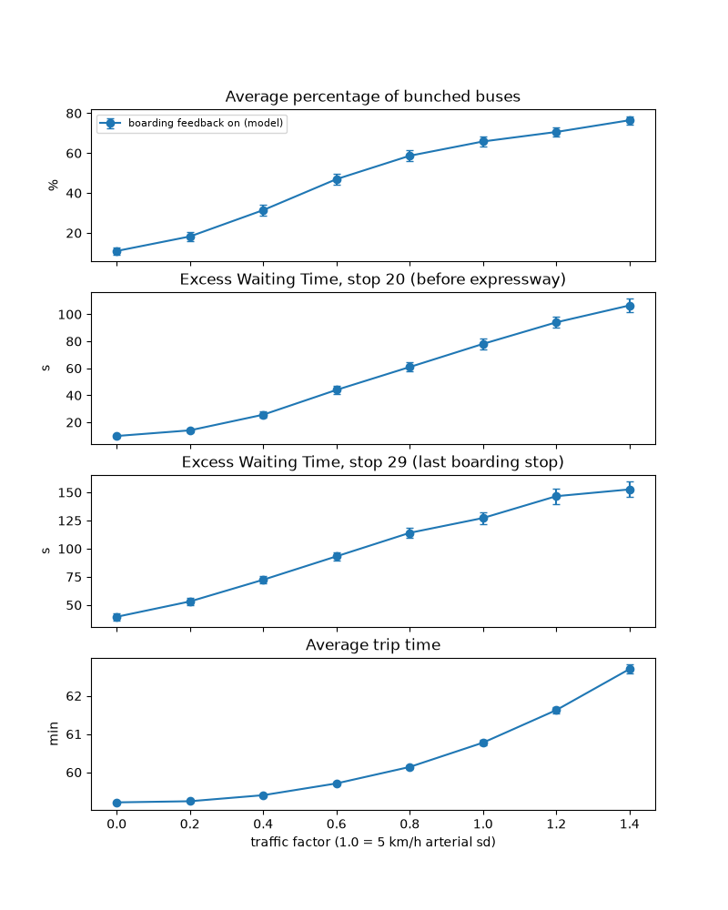
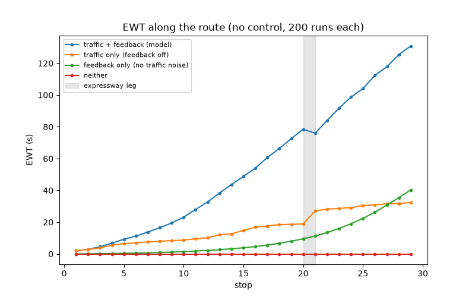
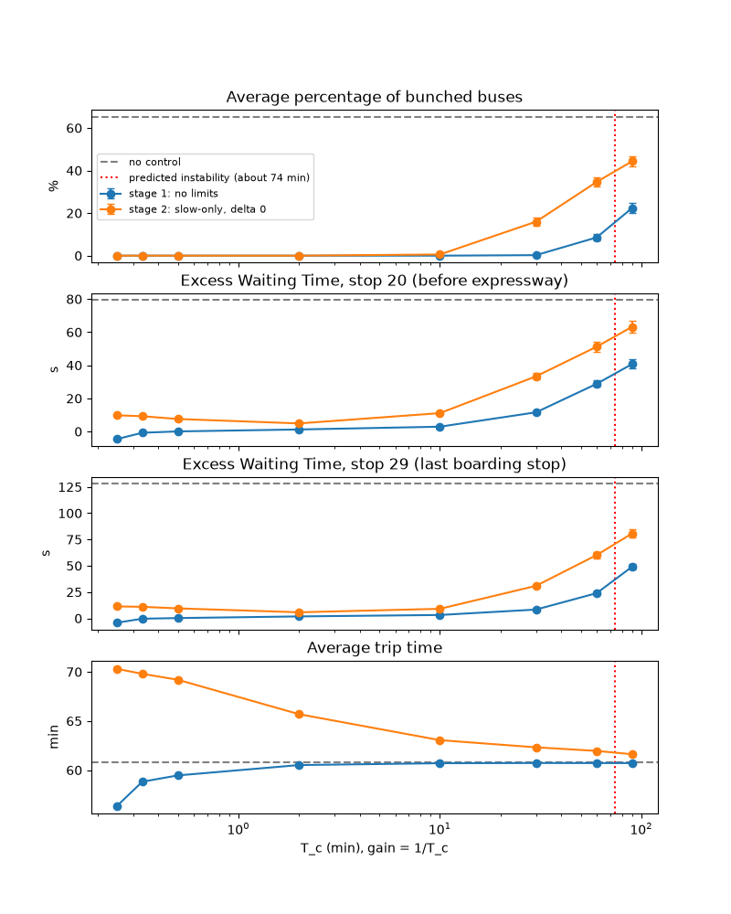

# Bus bunching on Singapore's bus 190

A simulation of bus bunching on SMRT service 190 (Kampong Bahru Terminal to Choa Chu Kang Interchange), built from real LTA stop-distance data and calibrated to the published timetable. The goal is to test a cooperative speed-control law (Daganzo and Pilachowski, 2011) under the constraints a Singapore operator actually faces. The main constraint is that buses can be slowed but not sped up.

**Status:** the uncontrolled baseline and a first controller are complete. The headroom trade-off, a discrete driver display and driver lag are in progress.

This project was also a way to extend my control background. What I learned along the way, and which results I derived myself, is in [docs/learning_log.md](docs/learning_log.md).


## Headline so far

Without control, bunching appears even with no traffic noise at all. Uneven passenger boarding alone bunches about 10% of buses over a two-hour evening peak. At the baseline traffic noise this rises to 64%, and excess wait time (EWT) reaches about 2 minutes by the last boarding stop.

A slow-only version of Daganzo and Pilachowski's cooperative speed control, which never asks a bus to go faster than traffic allows, cuts bunching from 64% to under 1% and EWT at the last boarding stop from 129 s to 9 s. It costs about 2.3 minutes of trip time. Adding the paper's speed headroom on top buys almost nothing more at this gain.

## Model

The model is tick-based, with 1-second ticks. Buses are dispatched every 5 minutes from 17:00 to 19:00, which gives 25 buses. Each run continues until every bus has reached the terminal.

- **Route:** 31 stops over 22.3 km, from the LTA DataMall BusRoutes API (direction 2). The data is cached in `data/route_190_dir2.json`. It includes a 9.1 km non-stop expressway leg between stop 20 (Raffles Town Club) and stop 21 (Blk 223).
- **Speed:** each bus draws one speed per leg, when it leaves a stop. The draw is a normal distribution truncated at the mean ± 3 sd, so the truncation does not shift the mean (with a floor of 5 km/h arterial and 3 km/h expressway). A *traffic factor* scales both standard deviations. Factor 1.0 is the baseline: 5 km/h on arterial roads, about 13 s of travel-time sd on a typical 0.45 km leg, and 1 km/h on the expressway. Because each bus draws its own speed, the sd represents how differently buses fare on the same leg, not day-to-day variation (which affects all buses alike and leaves headways unchanged). On arterial roads that difference is large (one bus catches a red light, the next a green). On a free-flowing expressway, buses a few minutes apart share conditions, so it is small.
- **Dwell:** a fixed 15.6 s per stop, plus 1.52 s per boarding passenger. Boardings are Poisson-distributed, with mean = arrival rate × time since the previous bus left that stop. Late buses therefore pick up more passengers and fall further behind, which is the feedback that causes bunching. The average dwell works out at 29.3 s.
- **Bunching:** a pair of consecutive buses is counted as bunched once the follower catches or passes its leader. Overtaking is allowed.

| Parameter | Value | Source |
|---|---|---|
| Stop distances | 31 stops, 22.3 km | LTA DataMall BusRoutes API |
| Headway H | 5 min | Midpoint of 190's PM-peak frequency of 3–7 min (DataMall BusServices) |
| Boarding time | 1.52 s per passenger | [Singapore bus stop study](https://www.sciencedirect.com/science/article/pii/S1077291X22000753) |
| Fixed stop delay | 5.6 s (doors) + 10 s (acceleration and deceleration loss) | Same study. It measured about 9 s to decelerate and 11 s to accelerate; with linear speed ramps, about half of each is lost time (our assumption). |
| Passenger arrivals | 10 per 5 min per stop, the same at every stop | Assumption. Bus capacity suggests about 6–10. |
| Arterial speed | 24.5 km/h (effective) | Calibrated to the 190 timetable, below |
| Expressway speed | 43 km/h (effective) | Calibrated to the 190 timetable, below |

### Calibration

The two speeds are *effective* speeds: they bundle traffic signals, congestion and merging into one number. They were fitted, with traffic noise off, to the scheduled 190 times for departures after 23:30.

| Checkpoint | Timetable | Simulated, no noise | Simulated, baseline noise |
|---|---|---|---|
| Stop 20 (9.0 km) | 32 min | 31.4 | – |
| Stop 21, Blk 223 (18.1 km) | 45 | 44.6 | – |
| Stop 29 (21.5 km) | 57 | 56.8 | 58.3 |

The last 0.8 km to the interchange takes 5–7 min in the timetable, against about 2.5 min in the simulation. This looks like terminal approach or recovery time rather than driving, and comes after the last boarding stop, so it was not fitted. Noisy legs are slower on average than noise-free ones, because slow legs cost more time than fast legs save. At baseline noise, the time to stop 29 therefore comes out 1.3 min above the timetable.

## Metrics

- **% of buses bunched:** the share of the 25 buses involved in at least one bunching event during the run. An isolated pair counts as 2.
- **Excess wait time (EWT):** at each stop, the headways h are the gaps between consecutive bus arrivals, in the order the buses physically arrive. Then

  AWT = Σh² / (2Σh),  SWT = H/2,  EWT = AWT − SWT.

  EWT is the extra time an average passenger, arriving at random, waits because buses are uneven. It is quadratic in headway, because long gaps both catch more passengers and make each of them wait longer. The first and last bus are left out.

  EWT grows along the route, so an average over all stops would hide where the problem is. It is reported at two stops: **stop 20**, the last stop before the expressway, and **stop 29**, the last boarding stop. The terminal is not used: it is alight-only, so its headways match no passenger's wait.
- **Trip time:** dispatch to terminal, averaged within each run. When control is added, this becomes the cost of control.

All results are means over independent runs with 95% confidence intervals (1.96 × sd / √runs). Each run counts as one sample, since buses within a run are not independent.

## Results: no control



The figure uses 100 runs per level. The table below uses 200 runs per level:

| Traffic factor (arterial sd) | % bunched | EWT stop 20 | EWT stop 29 | Trip time |
|---|---|---|---|---|
| 0 (boarding noise only) | 10.3 ± 1.2 | 9 ± 1 s | 38 ± 2 s | 59.2 min |
| 0.6 (3 km/h) | 45.6 ± 2.0 | 41 ± 2 s | 93 ± 3 s | 59.7 min |
| 1.0 (5 km/h, baseline) | 64.0 ± 1.6 | 77 ± 2 s | 129 ± 3 s | 60.8 min |
| 1.4 (7 km/h) | 75.6 ± 1.3 | 104 ± 4 s | 153 ± 5 s | 62.6 min |

- **Bunching is not only a traffic problem.** With traffic noise switched off, the boarding feedback alone still bunches about 10% of buses. This is the instability that the first term of Daganzo and Pilachowski's control law is designed to cancel.
- **Headway errors amplify along the route.** At baseline, EWT grows from about 24 s at stop 10 to 77 s at stop 20 and about 2 min at stop 29. Passengers late on the route bear most of the cost.
- **The baseline sits on the steep part of the curve,** so the controller will be tested at several noise levels rather than at the baseline alone.

### Why buses bunch: a disturbance and an amplifier

Two mechanisms drive bunching here. Each can be switched off separately:

- **Traffic noise:** random leg speeds.
- **Boarding feedback:** a late bus finds more passengers waiting, dwells longer and falls further behind. Switching it off gives every bus the model's average dwell (29.3 s), whatever its headway.



200 runs each, baseline traffic noise where on:

| Case | % bunched | EWT stop 20 | EWT stop 29 |
|---|---|---|---|
| Traffic noise + boarding feedback (model) | 64.2 ± 1.8 | 77 ± 3 s | 127 ± 4 s |
| Traffic noise only | 6.0 ± 1.0 | 19 ± 1 s | 26 ± 1 s |
| Boarding feedback only | 9.4 ± 1.3 | 9 ± 1 s | 38 ± 2 s |
| Neither | 0.0 | 0 s | 0 s |

- **Traffic noise alone makes headway errors accumulate like a random walk.** EWT rises roughly linearly along the route, but nothing amplifies the errors.
- **Boarding feedback alone amplifies even the small randomness in boarding numbers.** EWT starts near zero and accelerates along the route.
- **Together they are far worse than the sum:** 127 s at the last boarding stop, against 26 + 38 s. In control terms, the boarding feedback is an unstable plant and traffic noise is the disturbance it amplifies. This is why the controller needs a real restoring force, not just smoothing.
- **The expressway sd matters for an unexpected reason.** An earlier version used 3 km/h on the expressway, and EWT then stayed flat across that leg. The extra noise did add irregularity, but it also let about 5 of 23 buses per run swap order, splitting bunched pairs. That is an artefact of drawing every bus's speed independently. At 1 km/h, which is more realistic for free-flowing traffic (see Model), EWT rises steadily through the leg.

## Control

The controller is based on Daganzo and Pilachowski (2011). Each bus adjusts its speed using the gaps to the bus in front and the bus behind, as if neighbouring buses were joined by springs.

**Measuring the gaps.** The route has two speeds, 24.5 km/h arterial and 43 km/h on the expressway, so a distance gap does not translate directly into a time gap. The route is therefore mapped onto an *equivalent arterial* coordinate: the expressway leg is shrunk by 24.5/43, and each stop adds the distance an arterial bus covers during an average 29.3 s dwell. A gap in this coordinate divided by 24.5 km/h is a nominal time headway. This is a model-based estimate: it assumes nominal speeds and average dwells, not each bus's actual ones.

**The law.** Each bus gets a speed fraction r, which multiplies its drawn leg speed:

  r = 1 − δ + (e_front − e_rear) / T_c

Here e_front and e_rear are the front and rear headway errors (nominal headway − H), T_c sets the gain (α = 1/T_c), and δ is optional headroom. A bus with no neighbour, the first or the newest, treats the missing one as sitting at exactly the ideal headway. The target is refreshed every 10 s, as an in-cab display would be. Two configurations:

- **No limits:** any r. This checks the theory, not a realistic design.
- **Slow-only:** r is capped at 1, so a bus is never asked to go faster than traffic allows, with a floor of 0.5.

**Stability.** Two limits bound the gain. The 10 s refresh delays the feedback, which would cause oscillation for T_c below about 25 s. More interesting is a lower limit on the gain. This version leaves out the paper's term that cancels the boarding feedback, so the spring has to beat that instability on its own. Diagonalising the linearised chain gives every mode a growth rate proportional to (q·b·v̄ − 2α), where q is the passenger arrival rate per km, b the boarding time and v̄ the cruise speed. The spring therefore wins only if α > q·b·v̄ / 2, which here means T_c below about 74 min. Over a single trip of about an hour the transition is gradual: just past the limit, errors grow far more slowly than without control. In the sweep below, performance worsens smoothly as T_c approaches it.



200 runs each, baseline traffic noise:

| Configuration | % bunched | EWT stop 20 | EWT stop 29 | Trip time |
|---|---|---|---|---|
| No control | 64.0 ± 1.6 | 77 ± 2 s | 129 ± 3 s | 60.8 min |
| No limits, T_c = 10 min | 0.0 | 3 s | 3 s | 60.7 min |
| Slow-only, T_c = 10 min | 0.4 ± 0.3 | 11 ± 1 s | 9 ± 1 s | 63.1 min |
| Slow-only, T_c = 60 min | 32.9 ± 1.6 | 50 ± 2 s | 59 ± 2 s | 61.9 min |
| Slow-only, T_c = 30 s | 0.0 | 8 s | 9 s | 69.0 min |

- **Slow-only control works with a strong enough gain.** At T_c = 10 min it removes nearly all bunching. It costs about 2.3 min of trip time, because buses can only ever be slowed.
- **A weak gain is not enough when buses can only slow down.** At T_c = 60 min, slow-only control only halves bunching. A bus that falls behind cannot catch up, so half the spring is missing.
- **Too strong a gain is expensive.** At T_c = 30 s, buses spend much of their time at the speed floor, and trips take about 8 minutes longer.

**In progress:**

- the headroom trade-off: trip time against EWT as δ varies;
- a discrete driver display: the target shown as a few speed levels, refreshed every few seconds;
- driver response lag.

## Assumptions and limitations

- Traffic noise is independent across buses and legs. Real congestion is shared, so the baseline is probably pessimistic.
- Demand is uniform across stops. Bus capacity and alighting are not modelled, so a full bus keeps gaining boarding delay. This probably makes bunching worse than reality.
- Dispatch is perfectly even, which is optimistic.
- Buses can overtake freely.
- Speeds are lumped effective values, calibrated to off-peak (after 23:30) scheduled times. Peak trips are probably slower.
- H = 5 min is the midpoint of a published 3–7 min range. The real headway varies through the evening.
- The controller estimates headways from nominal speeds and average dwells, not from each bus's actual history.
- No acceleration limit is applied. The modelled speeds are effective averages, and the controller changes them by a fraction of a percent per update, far below what a bus can manage.

## How to run

```bash
python -m venv venv && source venv/bin/activate
pip install -r requirements.txt
python busBunch.py                 # no control (about 3 min): traffic_noise_sweep.png, feedback_profile.png
python tc_sweep.py                 # controller gain sweep (about 4 min): tc_sweep.png
python delta_sweep.py              # headroom sweep (about 6 min): delta_sweep.png, delta_tradeoff.png
python busBunchVisualisation.py    # one run, animated
```

The route is already cached. To refresh it from LTA DataMall, set your API key and run `routePull.py`:

```bash
export LTA_ACCOUNT_KEY="your-key"
python routePull.py
```

## References

- Daganzo, C. F. and Pilachowski, J. (2011). Reducing bunching with bus-to-bus cooperation. *Transportation Research Part B*, 45(1), 267–277.
- LTA DataMall: BusRoutes and BusServices APIs.
- Singapore bus stop study, ScienceDirect article S1077291X22000753 (boarding and stop-delay parameters).
